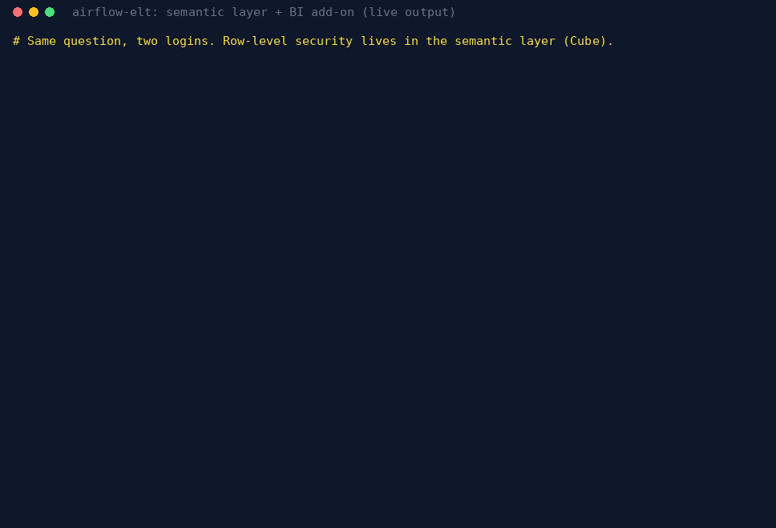

*Every company with more than one dashboard eventually has the meeting where two reports show two
different revenue numbers. Nobody is wrong. They just wrote the SQL differently.*

One report counts total charges, another counts fares only. One drops cancelled trips, another
doesn't. One computes the tip rate over every trip, another only over card payments, because cash
tips aren't recorded. Each choice makes sense alone. Together they produce a number nobody trusts.

A **semantic layer** is the standard fix. Instead of every report writing its own SQL, each business
measure is defined once, in one place, with its joins and filters. Reports, notebooks and BI tools ask
for `revenue` or `card_tip_rate` by name and get the same answer. This is the idea behind Power BI's
certified semantic models, and the same idea is available in open source through dbt's
**MetricFlow**.

I added one to [airflow-elt](https://github.com/godot107/airflow-elt), my public ELT pipeline on NYC
taxi data, to learn what it takes in practice.

## What was already there

The pipeline loads monthly NYC yellow-taxi trip files (about 3 million trips a month) into Postgres.
Each month goes through a data-quality gate before anything downstream sees it, and dbt builds a small
star schema: a `fct_trips` fact table with one row per kept trip, and a `dim_zones` dimension with the
city's 265 taxi zones. On top of those sit hand-written report tables ("marts"), such as daily revenue
by pickup zone.

Those marts work, but each one hard-codes its own measures. If I built a second report on the same
data, nothing would stop me from defining revenue a little differently.

## The semantic layer

The new layer lives in one YAML file and has three parts:

- **Semantic models** describe the tables in business terms. `trips` sits on the fact table. Two zone
  models sit on the dimension: one joined as the pickup location and one as the dropoff location, so
  "revenue by pickup borough" and "trips by dropoff borough" are both one-word requests.
- **Metrics** are the business definitions: `trips`, `revenue`, `revenue_per_trip`, `avg_fare`,
  `avg_miles`, `card_tip_rate` (card trips only, written into the definition so nobody can forget it),
  `trips_mtd` (month to date), and `kept_share`, the share of raw rows that passed the quality gate.
- **A time spine** is a plain calendar table, which MetricFlow needs to compute month-to-date totals.

Asking a question is now one line, with no SQL:

```bash
make mf ARGS="query --metrics trips,revenue_per_trip --group-by pickup_zone__borough --order -trips --limit 3"
```

```
pickup_zone__borough       trips    revenue_per_trip
Manhattan               23486153             24.1176
Queens                   2279721             72.416
Brooklyn                  400649             34.6533
```

Queens trips earn three times what Manhattan trips do because Queens has both airports. The same
pattern already shows up in the hand-written marts, which is the point.

## Defined is not the same as certified

A definition nobody checks can be wrong in the same quiet way a hand-written query can. So I added a
certification step, `make semantic-check`, in two parts:

1. **MetricFlow validates against the live warehouse.** Every semantic model, dimension, entity,
   measure and metric has to resolve to real columns and run.
2. **The metrics have to equal the reports they replace.** A short script asks MetricFlow for metrics
   by name and recomputes the same numbers from the existing marts: trips and revenue for every month
   and borough (64 groups), card tip rate and revenue per trip for every month, and the quality gate's
   kept share. Every value has to match to floating-point precision.

They all match. More usefully, if someone later edits a metric or a mart, the two stop agreeing and the
check fails. That turns "one definition per metric" from a convention into something a machine
enforces.

## What I learned

- **Most of the work is deciding what a metric means, not writing YAML.** The card-only tip rate is a
  good example. The data forces the rule, and putting it in the definition is the only way to stop the
  next report from forgetting it.
- **Joins belong in the model, not in each report.** Declaring pickup and dropoff zones as separate
  entities once meant no report has to remember which zone column joins to what.
- **Tools have rough edges.** The current MetricFlow release warns that my month-to-date metric has
  "both a measure and a metric" when it only has one. The numbers are right (February 29's
  month-to-date equals February's total), so I documented the warning and moved on.
- **Certification is what makes it governance.** A semantic layer without a check is a nicer place to
  write SQL. With the check, a metric is a published definition with evidence behind it, which is what
  "certified" should mean.

## From definitions to dashboards

Definitions on a command line help engineers. Business users need them in a dashboard, with the right
people seeing the right rows, and someone needs to know whether the certified version is the one people
actually use. So I added an optional BI layer, all open source:


<div class="caption">Definitions live in one layer; dashboards read them; usage flows back into the warehouse.</div>

- **Cube** serves the same eight metrics as a semantic model, through two "certified views": flat tables
  with the joins already done and only business fields exposed. It reads the warehouse through a login
  that can see the published report tables and nothing else.
- **Row-level security lives in that one place.** A `queens_analyst` login gets every trip query filtered
  to Queens, including a plain grand total. A caller with no role gets nothing.
- **A pre-built monthly rollup** answers the dashboard's month-by-borough question in about 20
  milliseconds, against 4.4 seconds for the same query run directly on the database.
- **Superset** draws the dashboard on top. Its datasets, metrics and dashboard carry Superset's
  "certified" badge, and a viewer role can open that one dashboard and nothing else: no raw datasets, no
  database connections, no SQL editor.


<div class="caption">The certified "Taxi operations" dashboard. The badge says who certified it and how; every number comes from a metric defined once in the semantic layer.</div>


<div class="caption">Live output, replayed: the same query as an admin returns every borough, as the Queens analyst only Queens, even for a grand total. Then the certification check runs.</div>

The certification check grew with it. It now proves the three copies agree (Cube, MetricFlow and the
hand-written reports), that row-level security holds through both of Cube's interfaces, that the rollup
is really used, and that the viewer's access is exactly what it should be.

## Measuring adoption

A certified dashboard nobody opens is not a win. Superset logs every dashboard view, chart load and chart
edit, so a daily Airflow job copies that log into the warehouse and dbt turns it into adoption numbers:
active viewers, active makers (people building their own charts), views, and the share of chart loads
that come from certified charts. It also flags uncertified charts built on certified data, which are the
candidates to certify or consolidate.

The users are demo accounts. Three viewers open the dashboard in a real browser, and one "citizen
developer" builds a chart of their own. Every event is real Superset telemetry, logged when it happened.
The first day showed 4 viewers, 1 maker, 7 dashboard views and 43 chart loads, 98% of them certified.
The one uncertified load is the citizen developer's chart, which is exactly what the metric exists to
catch. The counts mean nothing on demo traffic; what matters is that adoption is measured by the same
pipeline, with the same tests, as the data itself.

The code, the metric definitions and both check scripts are in the
[airflow-elt repository](https://github.com/godot107/airflow-elt), in the README's "Semantic layer" and
"BI add-on" sections.
